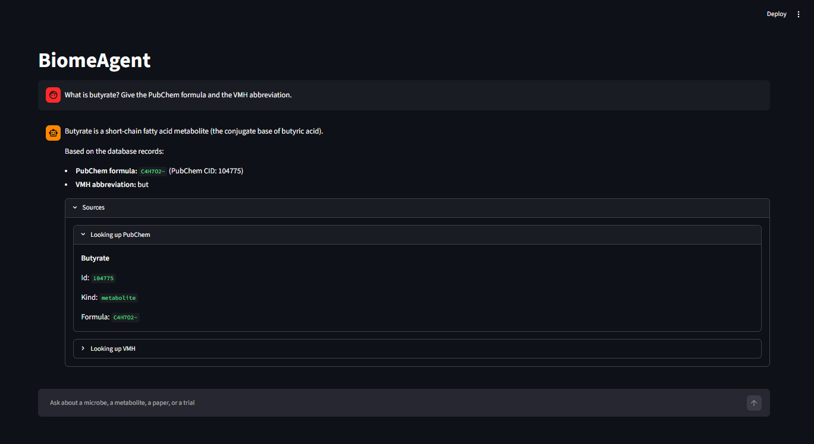

# BiomeAgent

[](https://github.com/mahziyarattar/biomeagent/actions/workflows/tests.yml)

BiomeAgent answers questions about microbes, metabolites, papers, and trials. You ask in ordinary language. A ReAct agent calls free public APIs, and the reply uses the records those calls return. Streamlit is the chat window. FastAPI runs the agent.



## Setup

Python 3.11 or newer.

```bash
python -m venv .venv
source .venv/bin/activate
pip install -e ".[dev]"
```

On Windows, activate with `.venv\Scripts\activate`.

Copy the env template and fill in the two required values:

```bash
cp .env.example .env
```

| Name | Required | What it is |
| --- | --- | --- |
| `OPENROUTER_API_KEY` | yes | OpenRouter key. The API will not call a model without it. |
| `OPENROUTER_MODEL` | yes | Model id. It must be a model that can call tools. |
| `BIOMEAGENT_API_URL` | no | Where Streamlit sends chat requests. Default `http://127.0.0.1:8000`. |
| `NCBI_EMAIL` | no | Contact email sent with NCBI Taxonomy requests. |
| `NCBI_API_KEY` | no | NCBI key. It raises the Taxonomy rate limit. |

The API reads `.env` from the project root when a chat request arrives. Streamlit does not read `.env`. It uses `BIOMEAGENT_API_URL` only when that variable is already in the environment. For a local run, leave it unset.

Keep `.env` out of git. The names above are the whole template in `.env.example`.

## Run the agent

From the project root, with the virtualenv active:

```bash
uvicorn biomeagent.main:app --reload
```

The API listens on `http://127.0.0.1:8000`. A full reply is `POST /chat`. The UI uses `POST /chat/stream`.

## Run the UI

In a second terminal, same virtualenv and directory, start Streamlit after the API is up:

```bash
streamlit run streamlit_app.py
```

Streamlit prints a local URL, usually `http://localhost:8501`. The page keeps the chat history in the browser session and sends that history with each question.

## Tests

Fixture tests do not use the network:

```bash
pytest
```

Live checks against Europe PMC, PubChem, NCBI Taxonomy, VMH, and OmniPath:

```bash
EVAL_LIVE=1 pytest tests/test_live.py
```

## License

The code is under the MIT license. See [LICENSE](LICENSE).

The Vazirmatn font files in `biomeagent/fonts/` stay under the SIL Open Font License. See [biomeagent/fonts/OFL.txt](biomeagent/fonts/OFL.txt).
